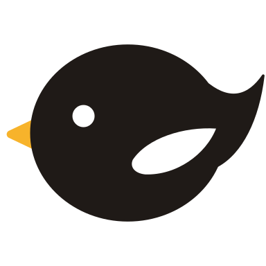

<p align="center">
  <picture>
    <source media="(prefers-color-scheme: dark)" srcset="docs/assets/kordi-bird-dark.svg">
    
  </picture>
</p>

<h1 align="center">Kordi</h1>

<p align="center">
  <strong>Building AI-native supercollaboration.</strong><br>
  Every communication in one place, with AI that is proactive and cooperative.
</p>

<h3 align="center">
  <a href="https://kordi.ai/download/mac">Download for Mac</a> &nbsp;·&nbsp; <a href="https://kordi.ai">Open kordi.ai</a>
</h3>

<p align="center">
  <a href="https://kordi.ai/iphone">iPhone (TestFlight)</a> ·
  <a href="docs/vps-deployment.md">Self-host</a> ·
  <a href="CHANGELOG.md">Changelog</a>
</p>

<!-- Product image: add one public product screenshot or GIF here (light and dark via <picture>). -->

## Get Kordi

- **Mac:** [download the app](https://kordi.ai/download/mac). Requires macOS 13 or later.
- **Web:** use Kordi in your browser at [kordi.ai](https://kordi.ai).
- **iPhone:** [apply for TestFlight](https://kordi.ai/iphone). Requires iOS 17 or later.
- **Self-host:** run your own server with the [VPS guide](docs/vps-deployment.md). The released apps connect to kordi.ai, so point a [source build](docs/run-cloud-desktop.md) at your server.

## What it does

- **People and agents in one chat.** Message contacts and groups, and mention your agent, or someone else's, in the thread where the context already is.
- **Your Mac runs your agent first.** When your Mac is online, your agent runs there with your tools and model sign-ins. When it is offline, the cloud runner takes over in a sandbox.
- **Cooperative and personal agents.** A cooperative agent follows your groups and asks you before it helps. A personal agent can message you first with updates.
- **Memory and connectors you control.** Memories are sorted by category and card, the Mac can import your `AGENTS.md` and `CLAUDE.md` files, and agents can use Google Calendar, Gmail, GitHub, Slack, and your Mac calendars and contacts.
- **Digests and plans.** Each chat becomes a digest of decisions and next steps, and the System agent keeps group plans and reminders.
- **Grounding.** Build profile cards from sources you choose, then find shared interests by tapping phones, joining a room code, or Nearby.

## Repository

| Path | What it is |
| --- | --- |
| [`app/desktop`](app/desktop) | Mac app (Tauri + React) |
| [`app/ios`](app/ios) | iPhone app (SwiftUI) |
| [`app/web`](app/web) | Web app, built on the desktop React pages |
| [`bridges/cloud-server`](bridges/cloud-server) | Hosted API (Rust) |
| [`bridges/cloud-agent-runner`](bridges/cloud-agent-runner) | Cloud agent runner and sandbox |
| [`shared/omp-runtime`](shared/omp-runtime) | Agent worker used on the Mac and in the cloud |
| [`agent`](agent) | Rust agent runtime: providers, tools, sessions |
| [`shared`](shared) | Cross-platform contracts and fixtures |
| [`docs`](docs) | Guides and design notes |

## Develop

You need macOS with the [Tauri prerequisites](https://v2.tauri.app/start/prerequisites/), Node.js 22+, pnpm 10.29.3+, a Rust toolchain from [rustup](https://rustup.rs/), and Docker with Compose v2.

```bash
git clone https://github.com/Kordi-AI/Kordi.git
cd Kordi
pnpm install --frozen-lockfile
pnpm debug:cloud:up

VITE_KORDI_CLOUD_API_BASE=http://127.0.0.1:17081 \
VITE_KORDI_DEV_PROFILE=community \
pnpm dev:desktop:profile -- --profile dev-isolated --title "Kordi Dev" --port 1422
```

This starts an isolated backend in Docker and opens a development build with a gray icon. Development builds refuse the production API, so use test accounts only. Before any other preview, follow [Development environments](docs/development-environments.md) and the [required preflight](docs/hosted-cloud-developer-guide.md#required-preflight-before-preview-or-debug).

Run `pnpm check` for lint, type checks and the Rust workspace check. More guides: [local development](docs/self-hosted-debug.md), [commands](docs/development.md), [iPhone development](docs/ios-development.md) and [architecture](docs/architecture.md).

## Contributing

Start with an issue, then open a focused pull request. The [community contributor guide](docs/community-contributor-guide.md) covers setup and testing, and [CONTRIBUTING.md](CONTRIBUTING.md) has the branch workflow and checklist. Kordi is in beta, so interfaces may still change.

## License

[MIT](LICENSE). Third-party components keep their own licenses; see [NOTICE](NOTICE).
