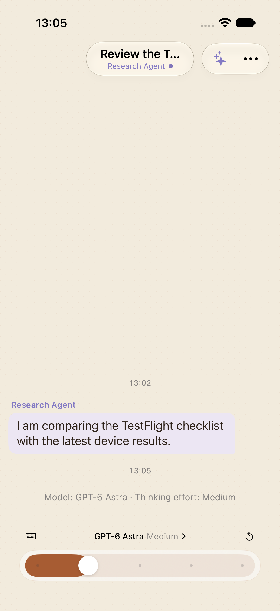

# Model and effort picker proposal

Interactive browser-only proposal for issue #1809, based on `origin/main` at
`132af0bed` and the supplied mobile and desktop effort-slider references.
It uses sample conversations and account labels. It does not connect to an API,
authenticate, send messages, or persist route changes outside the page.

Run a static HTTP server bound to `127.0.0.1` from this directory. The page accepts
`device=mac|ios`, `theme=light|dark`, `context=group|session|thread`, and
`unavailable=1`, and `palette=default|ocean|midnight|sand` query parameters. The iPhone view is a browser layout proposal,
not a native SwiftUI build.

Theme accents reuse Kordi’s existing light/dark palette values. The slider fill,
effort title, selection marks, focus rings, and surrounding surfaces follow the
selected palette. The effort popover is 232px wide, with only the current level, model link, reset,
and slider. It has no decorative lightning icon or explanatory captions.

## Proposed behavior

- One composer pill has two targets: model name opens the short model menu;
  effort opens the compact dotted slider. Both paths remain connected through
  the model link. The model menu does not repeat an effort row.
- Model names are readable; Default is first, with additional models in a
  searchable second view. The default model shown is an illustrative fixture.
- Model and effort selections apply immediately. Effort reset delegates to the
  model default rather than asserting that default means a specific level.
- Effort options follow the current iOS model constraints. Production code must
  use the shared discovered catalog and capability metadata, including custom
  providers and unknown model identifiers, rather than this illustrative subset.
- A provider change enters account selection. A shared-account change remains
  staged until confirmation; cancellation leaves the existing route intact.
- An unavailable account remains explicit. Recovery offers signed-in accounts
  of the same provider and requires confirmation in a shared context.
- The same control is proposed for main and thread composers and agent sessions;
  remove redundant header selectors when integrating it.

## Implementation follow-through

Share display-name and route-resolution logic across desktop entry points. Keep
raw identifiers in protocol payloads. Reuse existing permission checks, route
ownership, account-unavailable matching, and compatible-effort fallback logic.
Port the control to native SwiftUI with VoiceOver-adjustable effort selection.

The prototype applies changes in memory. The actual implementation must handle
save failures without announcing success, retain the last confirmed route, and
provide retry. It must also handle empty model catalogs, disconnected accounts,
read-only membership, custom model entry, and catalog loading. Update the existing
`composerModelSelection`, `compactComposerModelMenu`, and `AgentModelRouteUITests`
when implementing the production behavior.

## Native implementation capture

Captured from the Kordi Beta simulator with offline synthetic preview data.
The real composer uses the selected theme accent and readable model names.

The native iOS refinement uses an inline effort state in place of the composer,
with one model/effort label above the slider. It preserves the draft and keyboard.
The model menu anchors directly to the composer model control; the desktop
retains the compact popover shown in this original browser proposal.
